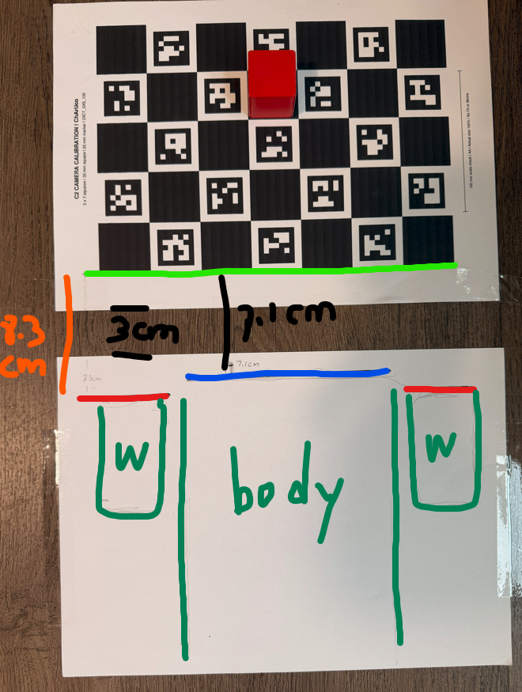

# Pain: the model looks aligned, but the real robot misses



## 1. Establish a reference independent of the fit

In this **one recorded setup**, the checker-pattern near edge was measured 8.3 cm from the frontmost wheel points and 7.1 cm from the chassis front. The paper-to-paper gap was 3 cm. A paper edge is not a pattern edge. The hand-drawn wheel/body outlines clarify references; they are not precision geometry or camera extrinsics.

If camera pose, board pose and robot geometry are all allowed to move during fitting, a good image match may hide a physically implausible layout. Fix independently measured constraints, then change one uncertain component at a time. Keep a held-out pose to check whether the correction transfers.

These dimensions are an example, **not values to copy to your robot**. [Original experiment and before/after images](https://mondaywmd.github.io/monday-robotics-universe/sim-to-real.html#measured-layout-and-grasp).

## 2. Separate the error sources

| Symptom | Measure first | Do not assume |
|---|---|---|
| Object reconstructed below the floor | Intrinsics, aligned depth, actual joint pose, camera-to-base transform and floor reference | Color segmentation must be wrong |
| Requested angle differs from endpoint | Command vs measured feedback, joint zero/sign, repeat measurements | PWM echo is measured position |
| Same nominal pose differs on return | Approach direction, hysteresis, compliance and independent measurements | One constant offset fixes the workspace |
| Static heading changes | Finite raw gyro, corrected gyro, timestamp and yaw series | Robot moved because the camera background changed |
| IMU/odometry becomes NaN | Read return codes, invalid markers, parser and initialization | It is only ordinary zero bias |

## 3. Run the offline reports

```sh
python analyze_errors.py points examples/synthetic_points.csv
python analyze_errors.py imu examples/synthetic_imu.csv
```

The synthetic points have a 1 cm X offset; the synthetic IMU has 0.003 rad/s yaw rate. The report gives measured-minus-expected offsets, 3D RMS, gyro mean/spread and unwrapped heading drift. Inputs require consistent units, coordinates and a single increasing clock domain. Heading unwrapping assumes less than pi rotation between adjacent samples. Non-finite values are rejected rather than converted to zero. The analyzer does not infer whether the robot was stationary and is not a calibration solver.

For joint errors, record separate columns for joint ID, requested angle, measured angle, approach direction and sample time. Use physical joint limits when interpreting angular differences; do not blindly wrap errors for a bounded servo.

## 4. Validate a correction, not just a number

1. Preserve raw observations and the original model.
2. Record where a candidate correction applies: robot, camera mount, pose range, temperature and firmware.
3. Compare before/after on the same reference, then test held-out poses and both approach directions.
4. Repeat across boots before calling a saved IMU bias reusable. Firmware startup bias and host correction can interact.
5. Record unresolved cases. Our later reboot restored finite data but still showed static heading drift; that is not a completed drift fix.

No firmware, camera mount matrix or robot-specific compensation is distributed here. Nothing in the analyzer applies a correction to hardware.

## 中文要点

尺子提供独立参照：棋盘图案边、纸边、前轮、车体前沿必须分清。不要同时移动所有模型参数来凑画面。相机误差、执行误差、IMU零偏分别测量；正反方向、不同姿态和不同开机分别验证。分享的是测量方法和分析工具，不是我们这台机器的补偿数字。
